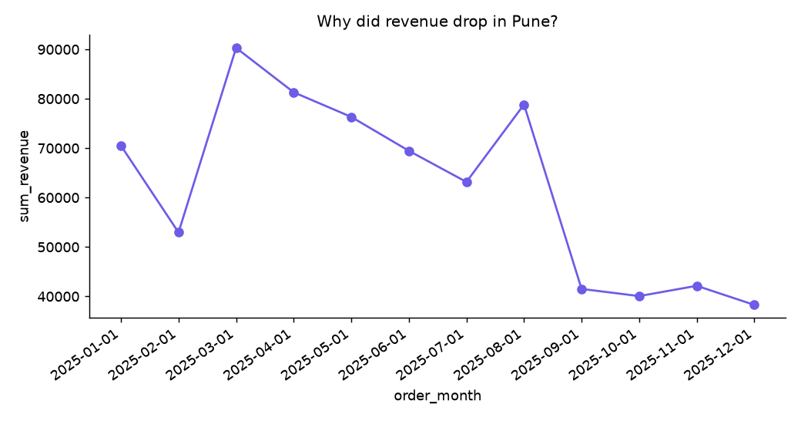
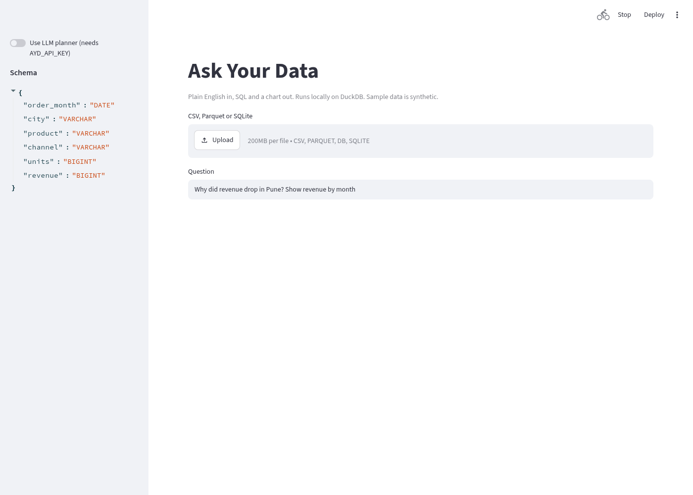
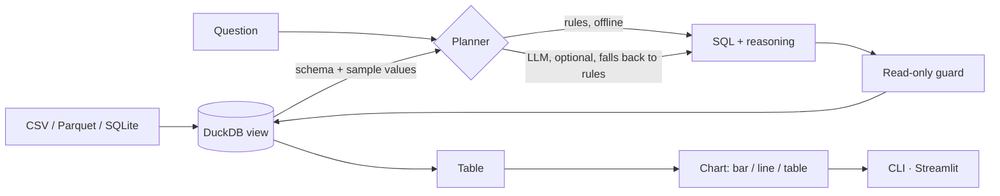

# Ask Your Data

**Plain English in, SQL and a chart out. Local-first on DuckDB, and it works with no API key.**

Ask "why did revenue drop in Pune?" about a CSV, Parquet or SQLite file. You get the SQL it ran, the reasoning behind it, a table and a chart. A transparent rule-based planner works fully offline. Plug in any OpenAI-compatible LLM (OpenAI, xAI, a local Ollama server) for harder questions. If the LLM fails, it falls back to the rules.



```
$ ask-your-data data/sample_sales.csv "Why did revenue drop in Pune?"
Reasoning:
  - Measure: 'revenue' (matched in question)
  - Aggregation: SUM
  - Filter: city = 'Pune' (value found in question)
  - Group by: order_month (monthly, because the question is about change over time)
SQL:
  SELECT date_trunc('month', "order_month") AS "order_month", ROUND(SUM("revenue"), 2) AS sum_revenue
  FROM data WHERE "city" = 'Pune' GROUP BY 1 ORDER BY 1
```
The sample dataset (`data/sample_sales.csv`, 576 rows) is **synthetic**, generated by `scripts_make_data.py` with a planted drop in Pune from September, so the demo has something to find.



## Quickstart
```bash
pip install -e ".[dev,ui]"
pytest -q
ask-your-data data/sample_sales.csv "total revenue by city" --chart out.png
streamlit run app.py
# optional LLM planner
export AYD_API_KEY=...  AYD_MODEL=...  AYD_BASE_URL=...   # any OpenAI-compatible endpoint
pip install -e ".[llm]" && ask-your-data data/sample_sales.csv "..." --llm
```

## Questions the rule planner understands
Aggregations (total, average, count/how many, max/highest, min/lowest), grouping (`by city`, `per product`), filters by any value that appears in the data (`in Pune`, `Online`), time trends (`trend`, `monthly`, `drop`, `change`), and `top N`. Anything beyond that is a job for the LLM planner.

## Safety
Only read-only `SELECT`/`WITH` statements are executed. DDL/DML and DuckDB commands such as `ATTACH`, `COPY` and `INSTALL` are rejected, including from LLM output. Data never leaves your machine unless you turn on a remote LLM.

## Architecture


## Roadmap
- [ ] Multi-table joins and schema descriptions
- [ ] "Why" mode: automatic driver breakdown (which segment explains the change)
- [ ] Query history and shareable answer links
- [ ] Local model presets (Ollama) and an eval set of question→SQL pairs

## Contributing

Issues and pull requests are welcome. Please run `pytest -q` before opening a PR, keep changes small and focused, and add a test for any new behaviour. Bigger ideas: open an issue first so we can agree on the shape.

## Licence
MIT. Built by [Shashwat Kumar](https://shashwat-kumar.github.io/shashwat-analytics/).
